<p align="center"><a href="https://github.com/eHomeLabs"></a><br><strong>eHome Labs</strong></p>

# NodOcean for HA

**Vos équipements EnOcean dans Home Assistant, simplement.**

Intégration communautaire indépendante développée par **eHomeLabs**, en cours d’ouverture aux équipements EnOcean de plusieurs fabricants.

> **Version expérimentale 0.9.0a2 — branche `develop/multibrand-enocean`.** Parcours famille → fabricant → modèle, ou famille → Generic → EEP. Premiers modèles Eltako FT55 / FT4F et EnOcean EMCSA sur base documentaire, à valider sur matériel. Quatre profils génériques en réception non chiffrée. [Installation et protocole de tests RPi5](docs/MULTIMARQUE_TESTS.md).

### Cadre de développement multimarque

- Conserver le domaine `nodon_enocean`, les identifiants uniques des appareils et entités, les configurations et les données d’appairage, y compris les identifiants d’émission.
- Prévoir une migration automatique et des tests de migration pour toute évolution du stockage ; vérifier la conservation des automatisations avant publication.
- Organiser le catalogue par fabricant et modèle, avec un socle de capacités par profil EEP et des adaptations propres aux produits.
- Préparer les parcours « Produit connu », « Apprentissage » et « Profil EEP avancé », selon les informations réellement disponibles.
- Distinguer systématiquement profil implémenté, modèle déclaré compatible et modèle testé sur matériel.
- Valider d’abord sur le RPi5 de tests, puis proposer les changements par pull request avant toute fusion dans `main`.
- Cette branche conserve la même identité technique que la version stable et la remplace sur l’instance de test. Elle ne constitue pas une seconde intégration à installer en parallèle sur cette instance.


Le principe : on choisit son produit dans une liste et Home Assistant fait le reste.
Pas de profil EEP à chercher, pas d'identifiant à recopier, pas de fichier YAML.

**Documentation complète : [wiki NodOcean for HA](https://github.com/eHomeLabs/NodOcean-for-HA/wiki)** (installation, appairage produit par produit, réglages, automatisations, FAQ).

[English version below](#english)

## Catalogue expérimental multimarque

| Fabricant | Modèles / profils | Fonctions | Statut |
|---|---|---|---|
| Eltako | FT55, FT4F — F6-02-01 | Événements des touches et déclencheurs d’appareil | Documentation constructeur ; matériel à tester |
| EnOcean | EMCSA 868 MHz — D5-00-01 | Ouverture / fermeture | Documentation constructeur ; matériel à tester |
| Generic | F6-02-01, D5-00-01, A5-02-05, A5-04-01 | Touches, ouverture, température et/ou humidité selon l’EEP | Profil seulement, modèle non certifié |

Nouveaux produits : réception non chiffrée et RSSI diagnostic ; aucun actionneur générique ni réglage constructeur. [Guide de tests et limites](docs/MULTIMARQUE_TESTS.md).

## Catalogue NodOn existant

| Visuel | Référence | Produit | Dans Home Assistant |
|:---:|---|---|---|
| 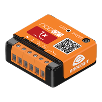 | **SIN-2-1-01** | Module Multifonction | Interrupteur |
| 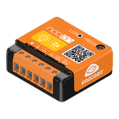 | **SIN-2-2-01** | Module Éclairage ON/OFF 2 canaux | 2 lumières |
| 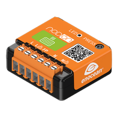 | **SIN-2-FP-01** | Module Chauffage Fil Pilote | Sélecteur de mode (6 ordres) + puissance + énergie |
| 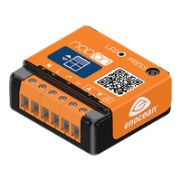 | **SIN-2-RS-01** | Module Volet Roulant | Volet avec position |
| 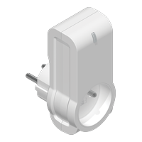 | **ASP-2-1-00 (FR)<br>ASP-2-1-10 (DE)** | Prise intelligente | Prise |
| 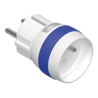 | **MSP-2-1-01 (FR)<br>MSP-2-1-11 (DE)** | Micro Smart Plug + Mesure | Prise + puissance + énergie |
| 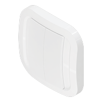 | **CWS-2-1-01** | Interrupteur mural sans pile | Événements par touche (haut/bas, gauche/droite, combinaisons) |
|  | **CRC-2-6-0x** | Soft Remote | Événements par bouton (4 boutons, combinaisons) |
| 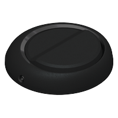 | **CFS-2-1-05** | Interrupteur de sol | Événements appui / relâchement |
| 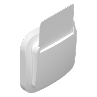 | **CCS-2-1-01** | Interrupteur à carte | Carte insérée (oui / non) |
| 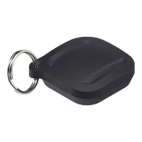 | **TSB-2-2-02** | Soft Button | Événements simple / double / long + batterie |
| 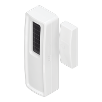 | **SDO-2-1-05** | Détecteur d'ouverture portes et fenêtres | Capteur d'ouverture |
| 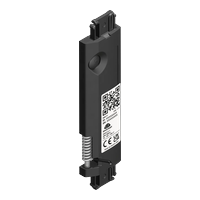 | **SWO-2-1-00** | Capteur d'ouverture invisible sans pile | Capteur d'ouverture |
| 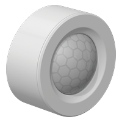 | **PIR-2-1-01** | Détecteur de mouvement | Mouvement + luminosité + tension pile |
|  | **STP-2-1-05** | Capteur de température | Température |
| 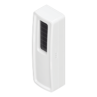 | **STPH-2-1-05** | Capteur de température et d'humidité | Température + humidité |

Chaque produit a en plus un capteur « Signal » (RSSI), désactivé par défaut.

## Aperçu

| 1. Choix du produit | 2. Consigne d'appairage |
|:---:|:---:|
| 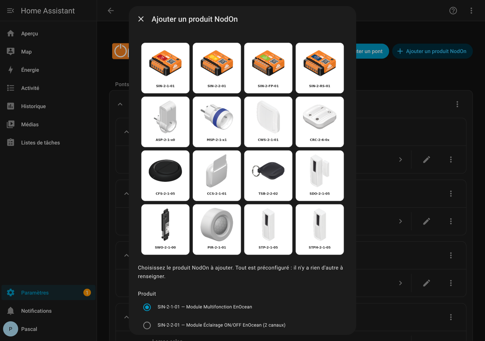 | 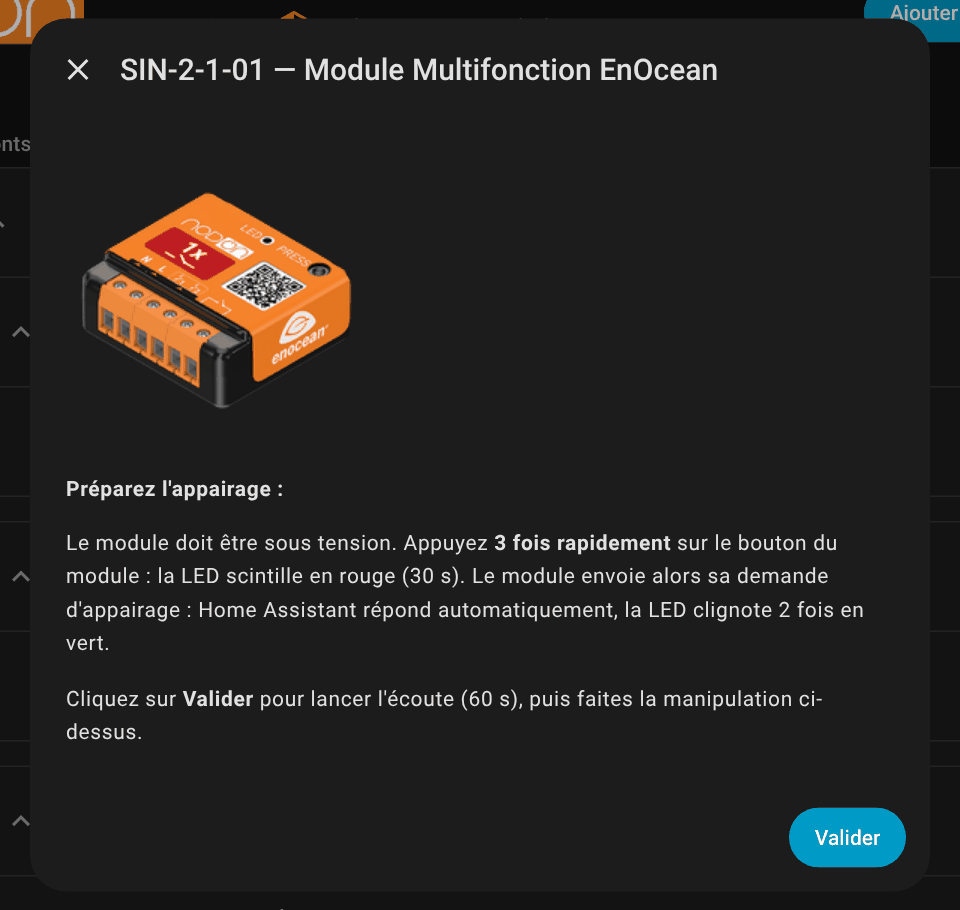 |
| **3. Nom et pièce** | **4. Fiche du produit et réglages** |
| 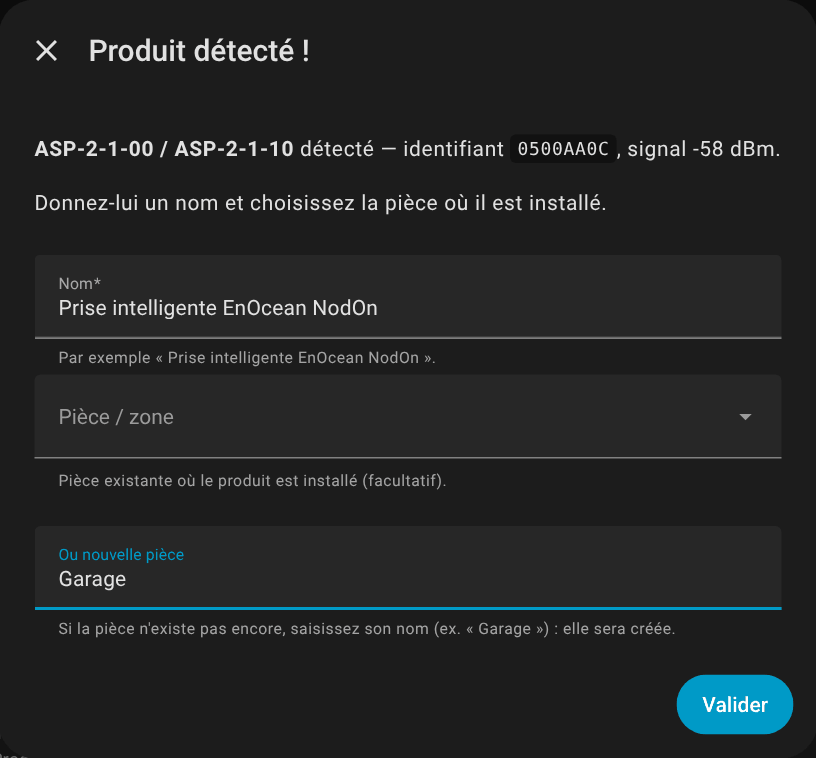 | 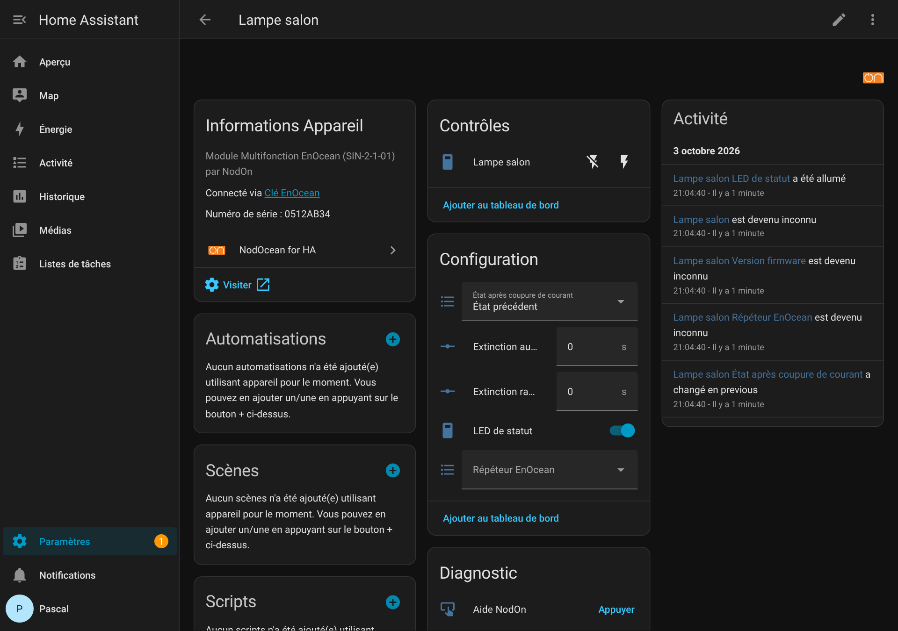 |

**5. Aide NodOn** : sur la fiche d'un produit, carte **Diagnostic** → **Aide NodOn** → **Appuyer**. La réponse s'affiche dans **Notifications** (en bas du menu de gauche) : notice du produit, support NodOn, contact et identifiant EnOcean.

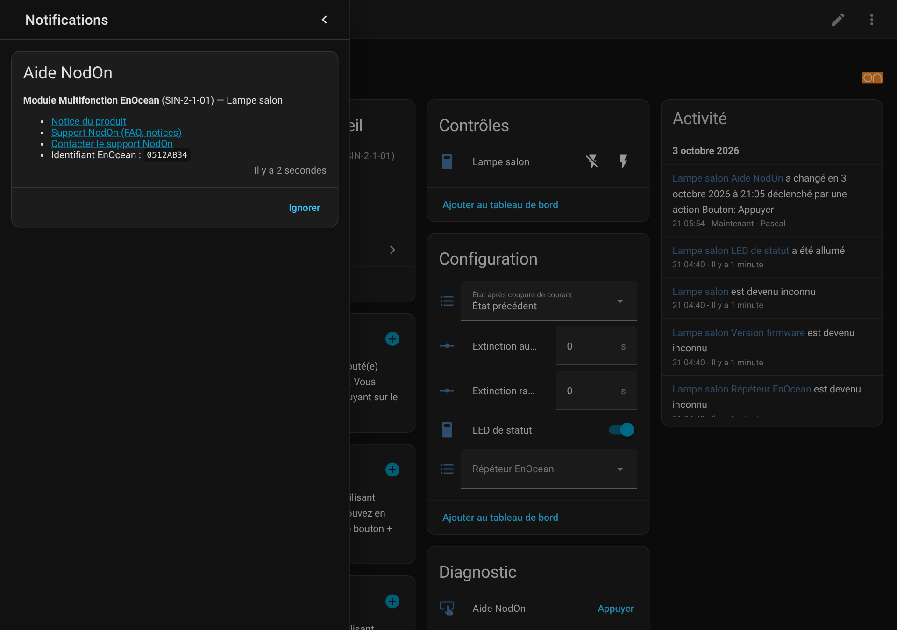

## Prérequis

- Home Assistant **2025.3** ou plus récent (toutes les installations : OS, Container, Core).
- Une clé USB EnOcean **USB300**, ou une clé compatible ESP3 (TCM310, USB500…).
- Pas de broker MQTT, pas d'add-on : l'intégration parle directement à la clé.
- Interface en français, anglais et allemand (selon la langue de Home Assistant).

> ⚠️ Si l'intégration EnOcean native de Home Assistant utilise déjà la clé, supprimez-la d'abord : une clé ne peut servir qu'à une seule intégration à la fois.

## Installation via Home Assistant Marketplace

Depuis **Home Assistant 2026.11**, le **Marketplace** remplace HACS et est intégré à Home Assistant : aucune installation préalable de HACS n'est nécessaire.

NodOcean for HA est disponible dans le **catalogue Marketplace** : aucun dépôt personnalisé n'est nécessaire.

1. Dans Home Assistant, ouvrez **Paramètres → Marketplace**.
2. Recherchez **NodOcean for HA**, ouvrez sa fiche, puis cliquez sur **Installer** et confirmez.
3. Suivez l'assistant de configuration qui s'ouvre après l'installation. Si nécessaire, allez dans **Paramètres → Appareils et services → Ajouter une intégration → NodOcean for HA**. Une clé USB300 branchée est normalement détectée automatiquement.
4. Si Home Assistant demande un redémarrage, effectuez-le avant de configurer l'intégration.

Accès direct à la fiche NodOcean for HA dans Marketplace :

[](https://my.home-assistant.io/redirect/hacs_repository/?owner=eHomeLabs&repository=NodOcean-for-HA&category=integration)

### Alternative : ajouter le dépôt depuis son lien

Si NodOcean for HA n'apparaît pas dans le catalogue :

1. Ouvrez **Paramètres → Marketplace → Ajouter depuis un lien** (*Add from link*).
2. Saisissez `https://github.com/eHomeLabs/NodOcean-for-HA`, puis cliquez sur **Ajouter**. Si un type est demandé, choisissez **Intégration**.
3. Ouvrez la fiche du dépôt ajouté et cliquez sur **Installer**.

L'ajout d'un dépôt personnalisé nécessite de connecter un compte GitHub au Marketplace. Les installations et dépôts personnalisés issus de HACS sont automatiquement migrés lors du passage à Home Assistant 2026.11 : **aucune réinstallation n'est nécessaire**.

Pour les versions de Home Assistant **antérieures à 2026.11**, utilisez HACS.

Guide détaillé : [page Installation du wiki](https://github.com/eHomeLabs/NodOcean-for-HA/wiki/Installation).

Installation manuelle : copiez le dossier `custom_components/nodon_enocean` dans le dossier `config/custom_components/` de Home Assistant, puis redémarrez.

## Ajouter un équipement EnOcean

1. Ouvrez l'intégration **NodOcean for HA** et cliquez sur **Ajouter un équipement EnOcean**.
2. Choisissez la famille **Capteurs et Sondes**, **Actionneurs** ou **Contrôleurs**, puis **NodOn**, **Eltako** ou **EnOcean**, puis le modèle ; ou **Generic**, puis le profil EEP exact. Lisez les fonctions disponibles et les limites affichées.
3. Suivez la consigne affichée (par exemple « appuyez 3 fois rapidement sur le bouton du module »), puis cliquez sur **Valider**.
4. Home Assistant écoute pendant 60 s. Il détecte le produit et répond lui-même à sa demande d'appairage pour les modules et les prises.
5. Donnez un nom au produit et choisissez sa pièce (ou créez-en une, par exemple « Garage ») : c'est terminé.

Pour les capteurs et les interrupteurs, si l'appairage échoue, vous pouvez aussi saisir l'identifiant EnOcean imprimé sur le produit.

### Comment ça marche

- **Modules SIN-2, prises ASP-2 / MSP-2.** Ils envoient une requête *UTE teach-in*, et l'intégration y répond automatiquement. Chaque actionneur reçoit son propre identifiant d'émission : le Base ID de la clé + un décalage de 1 à 127. Les commandes lui sont adressées directement.
- **Capteurs SDO-2 / SWO-2 / PIR-2 / STP-2 / STPH-2.** L'intégration détecte leur télégramme d'apprentissage (bit LRN).
- **Interrupteurs CWS-2-1 / CFS-2, Soft Remote, interrupteur à carte.** Le premier appui (ou la première insertion de carte) reçu pendant l'écoute est retenu.
- **Soft Button.** Il est reconnu grâce à sa requête UTE (5 appuis).
- **Interrogation.** Toutes les 60 s, l'intégration demande aux actionneurs leur état, leur puissance et leur énergie.

## Réglages des produits

Depuis la v0.2, chaque produit a ses réglages dans la carte **Configuration** de sa fiche appareil. Le lien **Visiter** de la fiche ouvre la notice du produit sur support.nodon.fr, et la carte **Diagnostic** affiche son visuel.

| Réglage | Produits | Valeurs |
|---|---|---|
| LED de statut (mode jour / nuit) | SIN-2-1-01, SIN-2-2-01, SIN-2-FP-01, ASP-2, MSP-2 | Allumée / éteinte |
| État après coupure de courant | SIN-2-1-01, SIN-2-2-01, SIN-2-FP-01, ASP-2, MSP-2 | Précédent / allumé / éteint |
| Bouton local | SIN-2-1-01, SIN-2-2-01, SIN-2-FP-01, ASP-2, MSP-2 | Actif / inactif |
| Type d'interrupteur filaire (v0.7) | SIN-2-1-01, SIN-2-2-01 | Automatique / interrupteur / interrupteur 2 états / poussoir |
| Télécommandes appairées en direct (v0.7) | SIN-2-1-01, SIN-2-2-01 | Actives / ignorées |
| Volet : type d'interrupteur, calibration, temps de course (v0.7) | SIN-2-RS-01 | Types 1 à 4 / classique, complète, arrêt / 5 à 300 s |
| Télécommandes appairées : liste, ajout par identifiant, suppression (v0.7) | Modules SIN-2, ASP-2 | Remote Commissioning, menu **⋮ → Reconfigurer** du produit |
| Détection de coupure secteur | ASP-2, MSP-2 | Active / inactive |
| Extinction automatique | SIN-2-1-01, SIN-2-2-01 (par canal), ASP-2, MSP-2 | 0 à 3600 s (0 = désactivée) |
| Extinction radio retardée | SIN-2-1-01, SIN-2-2-01 (par canal) | 0 à 3600 s |
| Répéteur EnOcean | Tous les modules et prises | Désactivé / niveau 1 / niveau 2 |
| Remise à zéro de l'énergie | MSP-2, SIN-2-FP-01 | Bouton |
| Correction de température / d'humidité | STP-2, STPH-2 | ± 5 °C / ± 20 % |
| Indisponible après | SDO-2, STP-2, STPH-2, PIR-2 | 0 à 1440 min sans message (0 = jamais) |
| Façade | CWS-2-1 | 4 boutons / 2 boutons |
| Aide NodOn | Tous | Bouton (carte Diagnostic) : appuyez sur **Appuyer**, puis ouvrez **Notifications** pour la notice, la FAQ et le contact du support NodOn |

- Les produits ne permettent pas de relire leurs réglages : Home Assistant affiche la dernière valeur envoyée. Les valeurs par défaut sont celles d'un produit neuf.
- Pour la MSP-2 et le SIN-2-FP-01, l'intégration règle elle-même le rapport automatique des mesures : toutes les 10 min au plus tard, ou dès 5 W / 10 Wh d'écart.
- Les interrupteurs CWS-2-1 et CFS-2, la Soft Remote et le Soft Button proposent des **déclencheurs d'appareil** dans l'éditeur d'automatisations (« Haut gauche appuyé », « Double appui »…).

## Pont MQTT (NodOcean to MQTT)

Depuis la v0.5.0, l'intégration peut aussi envoyer l'état des produits vers un **broker MQTT** local ou distant (Jeedom, Node-RED, serveur distant…) et recevoir des commandes, comme Zigbee2MQTT. Le pont est facultatif et désactivé par défaut.

- **Activer** : ligne **Clé EnOcean** → icône **⚙ Configurer** → adresse du broker, port, identifiant, mot de passe, TLS, topic de base. Conseil : créez un utilisateur dédié à NodOcean sur le broker.
- **États** : `nodocean/<produit>` en JSON, par exemple `{"state": "ON", "power": 12.5, "energy": 3.2, "rssi": -68}`.
- **Boutons** : `nodocean/<produit>/action` (`left_up`, `single`…).
- **Commandes** : `nodocean/<produit>/set`, par exemple `{"state": "ON"}`, `{"position": 50}` ou `{"mode": "eco"}`.
- **Statut** : `nodocean/bridge/state` (`online` / `offline`) et `nodocean/bridge/info` (liste des produits).
- **Options avancées (v0.6.0)** : télégrammes EnOcean bruts sur `nodocean/bridge/telegrams` (debug), et auto-découverte MQTT pour un **autre** Home Assistant branché sur le même broker (sur le même Home Assistant, les produits seraient en double).

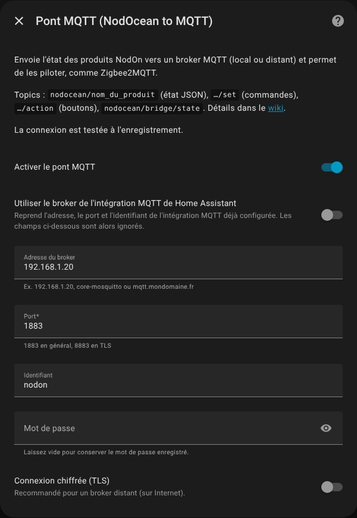 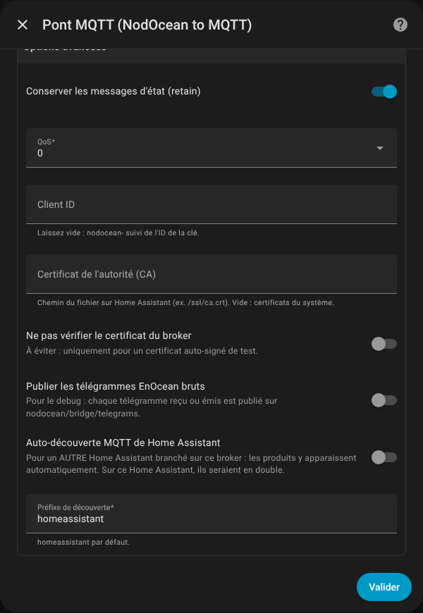

Tous les détails sont dans le wiki : [Pont MQTT](https://github.com/eHomeLabs/NodOcean-for-HA/wiki/Pont-MQTT).

## Supprimer un produit

Dans la liste des produits de l'intégration, faites **⋮ → Supprimer**. Pensez aussi à effacer l'appairage côté produit si besoin : réinitialisation usine, par exemple un appui de plus de 5 s sur le bouton des modules SIN-2.

## Dépannage

- **Diagnostics** : ⋮ de la ligne **Clé EnOcean** (ou d'une fiche appareil) → **Télécharger les diagnostics**. Joignez ce fichier à tout [rapport de bug](https://github.com/eHomeLabs/NodOcean-for-HA/issues/new?template=bug.yml).
- **Clé débranchée ou occupée** : une alerte s'affiche dans **Paramètres → Système → Corrections**.
- **Port ou clé changé** : ⋮ de la ligne **Clé EnOcean** → **Reconfigurer** (les produits sont conservés).
- **Doublons** : les messages répétés par les modules en mode répéteur sont filtrés automatiquement.

Journaux détaillés, dans `configuration.yaml` :

```yaml
logger:
  logs:
    custom_components.nodon_enocean: debug
```

Chaque télégramme reçu est alors journalisé (identifiant, RORG, données, RSSI).

## Retours et suggestions

Un problème, une suggestion ou un retour d'expérience ? [Ouvrez une issue sur GitHub](https://github.com/eHomeLabs/NodOcean-for-HA/issues/new/choose). Vos retours contribuent à améliorer NodOcean for HA.

Pour signaler un problème, indiquez la version de NodOcean for HA et de Home Assistant, la référence du produit et les étapes permettant de le reproduire. Joignez les diagnostics si possible (voir [Dépannage](#dépannage)), en vérifiant qu'ils ne contiennent pas d'informations personnelles.

## Développement

```bash
pip install pytest-homeassistant-custom-component pyserial-asyncio-fast paho-mqtt
pytest
```

Les tests utilisent un simulateur de clé USB300 (`tests/fake_dongle.py`) et les trames des Quick User Guides NodOn.
La fiche technique de chaque produit (EEP, trames, appairage, sources) est dans [docs/PRODUITS.md](https://github.com/eHomeLabs/NodOcean-for-HA/blob/main/docs/PRODUITS.md).

## Licence

MIT. Projet indépendant : il n'est ni affilié à Home Assistant / Nabu Casa, ni approuvé par eux.

---

## English

**Your EnOcean devices in Home Assistant, made simple.**

**NodOcean for HA** is an independent community integration developed by **eHomeLabs**, being expanded to multiple EnOcean manufacturers.

> Experimental 0.9.0a2 on `develop/multibrand-enocean`: family/manufacturer/model selection, Eltako FT55/FT4F and EnOcean EMCSA (hardware validation pending), and four receive-only generic EEP profiles. [RPi5 test guide](docs/MULTIMARQUE_TESTS.md). Existing model keys, identifiers and pairing data are retained.

 Pick your product from a list: Home Assistant handles the EEP profile, the device ID and the pairing response for you.

**Requirements:** Home Assistant 2025.3 or newer and an EnOcean USB300 (or ESP3-compatible) stick. No MQTT needed. An optional MQTT bridge (v0.5.0+) can also publish product states to a local or remote broker and accept commands, like Zigbee2MQTT, with optional Home Assistant MQTT discovery and raw telegrams (v0.6.0). UI in English, French and German.

**Full documentation:** [English documentation (wiki)](https://github.com/eHomeLabs/NodOcean-for-HA/wiki/English-documentation).

**Install via Home Assistant Marketplace (Home Assistant 2026.11+):** The Marketplace replaces HACS and is built into Home Assistant. NodOcean for HA is available in the default catalog; no custom repository is required.

1. Open **Settings → Marketplace** and search for **NodOcean for HA**.
2. Open its page, click **Install**, and confirm.
3. Follow the integration setup flow. If it does not open automatically, go to **Settings → Devices & services → Add integration → NodOcean for HA**.
4. Restart Home Assistant only if prompted.

Direct link to NodOcean for HA in Marketplace:

[](https://my.home-assistant.io/redirect/hacs_repository/?owner=eHomeLabs&repository=NodOcean-for-HA&category=integration)

**Alternative: add from link.** If NodOcean for HA is not listed, open **Settings → Marketplace → Add from link**, enter `https://github.com/eHomeLabs/NodOcean-for-HA`, add it (select **Integration** if asked), and install it from its page. Adding a custom repository requires connecting GitHub to the Marketplace.

Existing HACS installations and custom repositories migrate automatically on Home Assistant 2026.11; **no reinstallation is needed**. On Home Assistant versions **before 2026.11**, continue using HACS.

**Add a device:** click **Add an EnOcean device**, choose the family, manufacturer and model, or **Generic** and the exact EEP profile. Read the available functions and limitations, then follow the pairing instructions and give it a name.

Supported: SIN-2-1-01, SIN-2-2-01, SIN-2-FP-01, SIN-2-RS-01, ASP-2, MSP-2, CWS-2-1, CRC-2, CFS-2, CCS-2, TSB-2, SDO-2, SWO-2, PIR-2, STP-2, STPH-2.

### Feedback and suggestions

Found a problem, have a suggestion or want to share your experience? [Open an issue on GitHub](https://github.com/eHomeLabs/NodOcean-for-HA/issues/new/choose). Your feedback helps improve NodOcean for HA.

When reporting a problem, include your NodOcean for HA and Home Assistant versions, the product model and the steps to reproduce it. If possible, attach diagnostics from the EnOcean stick entry's **⋮ → Download diagnostics** menu after checking for personal information.
